<div align="center">


<br/>



[](https://integrated-ml-capstone-cksmcztxcjd42mjysqywzv.streamlit.app)

### 🐍 **Team Cobra Tech** — three tracks, three real-world datasets, one question:
### *can machine learning make roads smarter and safer?*

</div>


## 🧭 Quick navigation

| | Section | What you'll find |
|---|---|---|
| 🏁 | [Project at a glance](#glance) | The three tracks, headline results, datasets |
| 👥 | [Team](#team) | Who we are |
| 🗂️ | [Datasets](#datasets) | The three Kaggle datasets we used (links included) |
| 🔬 | [How every track works](#pipeline) | The shared ML workflow, step by step |
| 📈 | [Track 1 · Regression](#regression) | Metro Interstate Traffic Volume |
| 🚨 | [Track 2 · Classification](#classification) | Road Traffic Severity |
| 🗺️ | [Track 3 · Clustering](#clustering) | Microsoft GeoLife GPS Trajectory |
| 🏆 | [Scoreboard](#scoreboard) | All results in one place |
| ⚠️ | [Limitations & future work](#limits) | What we'd improve next, honestly |
| ▶️ | [Run it yourself](#run) | Setup, notebook order, folder layout |


<a id="glance"></a>
## 🏁 Project at a glance

Roads generate three kinds of questions, and each one needs a different kind of machine learning:

| Question | ML task | Dataset | Our answer |
|---|---|---|---|
| *"How many vehicles will be on the highway at 4 pm on a Tuesday?"* | **Regression** (predict a number) | Metro Interstate Traffic Volume | Random Forest, **R² = 0.956** |
| *"How severe will this accident be?"* | **Classification** (predict a category) | Road Traffic Severity | Bagging (Decision Tree), **weighted F1 = 0.796** |
| *"Where do GPS points naturally group together?"* | **Clustering** (find structure, no labels) | Microsoft GeoLife GPS Trajectory | K-Means, **silhouette = 0.848** |

<div align="center">
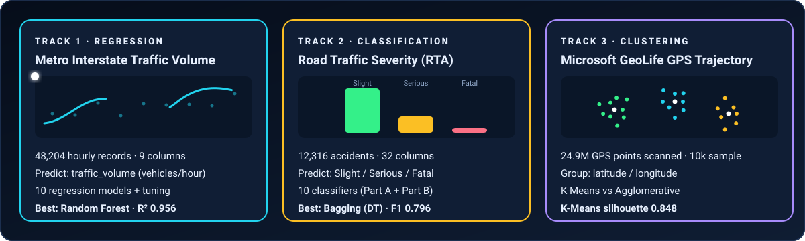
</div>

**22 algorithms** were trained and compared across the three tracks (10 regression + 10 classification + 2 clustering), all with leakage-safe scikit-learn pipelines and a fixed random seed.


<a id="team"></a>
## 👥 Team

**Team name: 🐍 Cobra Tech**

| Member | Role | Contact |
|---|---|---|
| _add name_ | _e.g. Regression track_ | _GitHub / email_ |
| _add name_ | _e.g. Classification track_ | _GitHub / email_ |
| _add name_ | _e.g. Clustering track_ | _GitHub / email_ |

> Course: **23CSE301 — Machine Learning Capstone Project**


<a id="datasets"></a>
## 🗂️ Datasets

| Track | Dataset | Link | Size used | Target / goal |
|---|---|---|---|---|
| 📈 **Regression** | Metro Interstate Traffic Volume | [Kaggle notebook & data](https://www.kaggle.com/code/ramyahr/metro-interstate-traffic-volume/data) | 48,204 rows × 9 columns | `traffic_volume` (vehicles per hour) |
| 🚨 **Classification** | Road Traffic Severity Classification | [Kaggle dataset](https://www.kaggle.com/datasets/avikumart/road-traffic-severity-classification) | 12,316 rows × 32 columns | `Accident_severity` (3 classes) |
| 🗺️ **Clustering** | Microsoft GeoLife GPS Trajectory | [Kaggle dataset](https://www.kaggle.com/datasets/arashnic/microsoft-geolife-gps-trajectory-dataset?utm_source) | 24,876,978 GPS rows (1.57 GB) → 10,000-point sample | Natural geographic groups (no label) |

> 📦 The two smaller CSVs are already in [`data/`](data/). The GeoLife file (1.57 GB) is too large to ship, so download it from Kaggle (see [Run it yourself](#run)).

<details>
<summary><b>📖 Column dictionary — Metro Interstate Traffic Volume</b></summary>

| Column | Meaning |
|---|---|
| `holiday` | US national holiday or regional holiday (e.g. State Fair); `None` on ordinary days |
| `temp` | Temperature in **Kelvin** |
| `rain_1h` | Rain in the last hour (mm) |
| `snow_1h` | Snow in the last hour (mm) |
| `clouds_all` | Cloud cover (%) |
| `weather_main` / `weather_description` | Short and detailed weather category |
| `date_time` | Hour of the observation (local time) |
| `traffic_volume` | **Target** — hourly traffic volume |

</details>

<details>
<summary><b>📖 Column dictionary — Road Traffic Severity (RTA)</b></summary>

32 columns describing the **driver** (age band, sex, education, experience), the **vehicle** (type, owner, service years, defects), the **road** (area, lanes, alignment, junction, surface, surface condition), the **environment** (light, weather), the **crash** (collision type, vehicles involved, casualties, vehicle movement), the **casualty** (class, sex, age band, work, fitness, pedestrian movement), the **cause of accident**, and the **time/day**.
**Target:** `Accident_severity` → `Slight Injury`, `Serious Injury`, `Fatal injury`.

</details>

<details>
<summary><b>📖 Column dictionary — Microsoft GeoLife GPS Trajectory</b></summary>

| Column | Meaning |
|---|---|
| `UserID` | Anonymous user who carried the GPS logger |
| `TrajectoryID` | Identifier of one recorded trip |
| `Latitude`, `Longitude` | GPS position in degrees |
| `Altitude` | Altitude reported by the device |

</details>


<a id="pipeline"></a>
## 🔬 How every track works (the shared workflow)

All three tracks follow the same disciplined recipe. Think of it as a factory line the data rides along:


**Three rules we never broke**

1. 🔒 **No data leakage.** Imputers, scalers and encoders are *fitted on the training split only*, then applied to the test split.
2. ⚖️ **Fair comparison.** Every model in a track sees the *same* train/test split (80 / 20, fixed `random_state`).
3. 🧪 **Test set is for judging, not choosing.** Hyper-parameters are chosen with cross-validation on the training data.

<details>
<summary><b>🧩 What does the preprocessing pipeline actually do?</b></summary>

| Feature type | Step 1 — fix gaps | Step 2 — make it model-ready |
|---|---|---|
| Numeric (e.g. `temp`, `hour`) | Fill missing with the **median** | **StandardScaler** → mean 0, std 1 |
| Categorical (e.g. `weather_main`, `Day_of_week`) | Fill missing with the **most frequent** value | **One-hot encoding** → a 0/1 column per category |

Why it matters: models such as SVR, KNN, MLP and the regularised linear models are sensitive to feature scale; models cannot read text categories directly; and fitting these steps on training data only keeps the test score honest.

</details>


<a id="regression"></a>
## 📈 Track 1 · Regression — Metro Interstate Traffic Volume

> **Goal:** predict the **hourly traffic volume** on a US interstate from weather, holidays and time features.
> Dataset: [Metro Interstate Traffic Volume](https://www.kaggle.com/code/ramyahr/metro-interstate-traffic-volume/data) · Notebook: [`notebooks/regression.ipynb`](notebooks/regression.ipynb)

<div align="center">
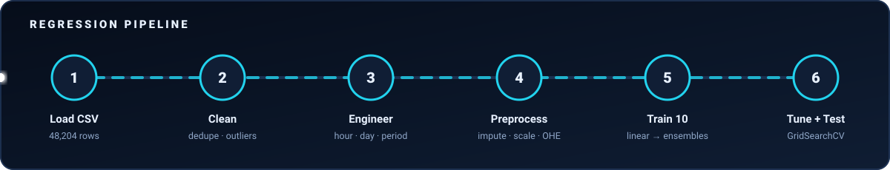

</div>

### 🔎 1. What the data looks like (EDA)

| Fact | Value |
|---|---|
| Rows × columns | 48,204 × 9 |
| Target `traffic_volume` | mean **3,260**, median 3,380, std 1,987, min 0, max 7,280 |
| Missing values | Only `holiday` (48,143 blanks — meaning *"not a holiday"*, not bad data) |
| Duplicate rows | 17 (removed) |
| Holiday rows | Just 61 in total, spread over 11 holidays |

The traffic distribution is wide and **not bell-shaped** — there are lots of near-empty night hours *and* lots of busy rush hours. That alone hints that a straight line will struggle.

<div align="center">
</div>

**What the chart tells us** (computed straight from the CSV):

- 🌅 **Weekdays have a double rush-hour shape**: a sharp climb at 05:00–07:00, a midday plateau, then the **peak at 16:00 (≈ 6,189 vehicles/hour)**.
- 🛋️ **Weekends are one smooth hill** that peaks around midday (≈ 4,372).
- 🌙 The quietest hour is **02:00 on weekdays (≈ 302)**.
- 🎄 On the 61 holiday rows the average volume is only **≈ 865 vehicles/hour**, against ≈ 3,263 on all other rows — holidays strongly depress traffic, though 61 rows is a small sample.

### 🧹 2. Cleaning

| Problem found | What we did | Why |
|---|---|---|
| 17 duplicate rows | Dropped → **48,187** rows | Repeated rows would bias training |
| `holiday` blank for 48,143 rows | Filled with the label **`None`** | Blank here *is* information ("ordinary day") |
| 10 rows with `temp = 0 K` (≈ –273 °C, physically impossible) | Set to missing, imputed in the pipeline | Sensor glitch, not weather |
| 1 row with `rain_1h = 9,831.3 mm` (next largest is 55.6 mm) | Set to missing, imputed in the pipeline | Obvious data-entry error |

### 🛠️ 3. Feature engineering

The raw `date_time` text is useless to a model, so we unpacked it into signals a model can learn from:

| New feature | Example | Why it helps |
|---|---|---|
| `hour` | 9 | Captures the daily rhythm |
| `day_of_week` | 1 (Tuesday) | Weekday vs weekend behaviour |
| `month`, `year` | 10, 2012 | Seasonality and long-term trend |
| `is_weekend` | 0 / 1 | A direct switch for the weekend hill |
| `traffic_period` | Morning / Afternoon / Evening / Night | A coarse "time of day" bucket |

After one-hot encoding, the model sees **74 features** (38,549 training rows / 9,638 test rows).

### 🤖 4. The 10 models — how each one thinks

| # | Model | The idea in one line | Test R² |
|---|---|---|---|
| 1 | **Linear Regression** | One weighted sum of all features — the baseline | 0.7311 |
| 2 | **Ridge** | Linear + an L2 penalty that shrinks big weights | 0.7312 |
| 3 | **Lasso** | Linear + an L1 penalty that can drop useless features | 0.7314 |
| 4 | **ElasticNet** | A blend of the Ridge and Lasso penalties | 0.7169 |
| 5 | **Polynomial (degree 2)** | Adds squares & pairwise interactions (74 → **2,849** features) so a linear model can bend | 0.8510 |
| 6 | **Decision Tree** | A flowchart of yes/no questions on feature thresholds | 0.9417 |
| 7 | **Random Forest** | Hundreds of de-correlated trees voting (averaging) | **0.9546** |
| 8 | **Gradient Boosting** | Trees added one at a time, each fixing the previous errors | 0.9313 |
| 9 | **SVR** | Fits a tube around the data using a kernel | 0.8294 |
| 10 | **KNN** | Predicts the average of the most similar past hours | 0.8306 |

<div align="center">
</div>

<details>
<summary><b>📋 Full metrics table (R², RMSE, MAE on the held-out test set)</b></summary>

| Rank | Model | R² | RMSE | MAE |
|---:|---|---:|---:|---:|
| 1 | Random Forest | 0.9546 | 425.82 | 238.57 |
| 2 | Decision Tree | 0.9417 | 482.93 | 283.21 |
| 3 | Gradient Boosting | 0.9313 | 524.20 | 343.25 |
| 4 | Polynomial Regression | 0.8510 | 771.85 | 575.59 |
| 5 | KNN | 0.8306 | 822.86 | 579.31 |
| 6 | SVR | 0.8294 | 825.96 | 601.18 |
| 7 | Lasso | 0.7314 | 1,036.34 | 795.32 |
| 8 | Ridge | 0.7312 | 1,036.65 | 795.55 |
| 9 | Linear Regression | 0.7311 | 1,036.80 | 795.62 |
| 10 | ElasticNet | 0.7169 | 1,063.81 | 842.84 |

**Reading the metrics:** *R²* is the share of variation explained (1.0 is perfect). *RMSE* and *MAE* are average errors in **vehicles per hour**; RMSE punishes big misses more, MAE is the plain average miss.

</details>

**💡 Why did trees crush the linear models?** Traffic vs. hour is *not a straight line* — it has two peaks and a deep night valley, exactly as the chart above shows. All four linear models stall at R² ≈ 0.73 because a single weighted sum cannot draw that shape. Trees split the day into pieces, so they can.

### 🎛️ 5. Cross-validation and tuning

| Step | Result |
|---|---|
| 5-fold CV of the top 2 | Random Forest **0.9483 ± 0.0038** · Decision Tree 0.9344 ± 0.0040 |
| GridSearchCV (12 candidates × 5 folds = 60 fits) — **Random Forest** | best `max_depth=20`, `min_samples_split=5`, `n_estimators=200` → CV R² **0.9500** |
| GridSearchCV — **Gradient Boosting** | best `learning_rate=0.1`, `max_depth=4`, `n_estimators=200` → CV R² 0.9468 |

| Model | Before tuning | After tuning |
|---|---|---|
| Random Forest | R² 0.9546 · RMSE 425.8 · MAE 238.6 | **R² 0.9561 · RMSE 418.7 · MAE 230.1** |
| Gradient Boosting | R² 0.9313 · RMSE 524.2 · MAE 343.3 | R² 0.9524 · RMSE 436.0 · MAE 259.1 |

Tuning helped Gradient Boosting a lot (+0.021 R²) and Random Forest a little (+0.0015 R²) — the forest was already near its ceiling. **Final model: tuned Random Forest.**

### 🧠 6. What the model learned

<div align="center">
</div>

**Time of day dominates.** `traffic_period_Night` (0.584) and `hour` (0.254) together carry ~84 % of the importance; `day_of_week` and `is_weekend` add more. Temperature is a minor factor (0.024), and rain and cloud cover contribute little.

**Residual check.** Predicted-vs-actual points hug the diagonal and residuals centre on zero (no strong overall bias). Errors do grow at higher traffic volumes (mild heteroscedasticity) — the busiest hours are the hardest to call exactly.

> ✅ **Regression takeaway:** knowing *when* it is explains almost everything about highway traffic. A tuned Random Forest predicts hourly volume to within about ±420 vehicles (RMSE) on data it never saw.


<a id="classification"></a>
## 🚨 Track 2 · Classification — Road Traffic Severity

> **Goal:** predict how severe a road accident will be — **Slight**, **Serious** or **Fatal** — from driver, vehicle, road, weather and time information.
> Dataset: [Road Traffic Severity Classification](https://www.kaggle.com/datasets/avikumart/road-traffic-severity-classification) · Notebooks: [`classification.ipynb`](notebooks/classification.ipynb) (Part A) and [`classification-2.ipynb`](notebooks/classification-2.ipynb) (Part B + consolidated comparison)

<div align="center">


</div>

### 🔎 1. The big challenge: heavy class imbalance

<div align="center">
</div>

Out of 12,316 accidents, **10,415 are Slight, 1,743 Serious, and only 158 Fatal (1.3 %)**. A lazy model that always answers *"Slight"* is ≈ 85 % accurate and completely useless. So we judge models by **weighted F1, ROC-AUC and per-class recall**, never accuracy alone.

| Fact | Value |
|---|---|
| Duplicate rows | 0 |
| Numeric columns | `Number_of_vehicles_involved` (1–7, mean 2.04), `Number_of_casualties` (1–8, mean 1.55) |
| Accidents by period | Afternoon 3,897 · Evening 3,496 · Morning 3,312 · **Night 1,611** |

### 🧹 2. Cleaning & features

| Step | Detail |
|---|---|
| **Hidden missing values** | The text `"na"` is used for blanks. We converted it to a real missing value, which uncovered large gaps: casualty columns ≈ 4,443 missing, `Defect_of_vehicle` 4,427, `Service_year_of_vehicle` 3,928, `Work_of_casuality` 3,198, `Fitness_of_casuality` 2,635 … |
| **Imputation** | Median for numbers, most-frequent for categories — **fitted on training data only** |
| **Time → features** | The `Time` string was parsed into `Hour` and a `Traffic_Period` bucket (Morning / Afternoon / Evening / Night) |
| **Outcome-style column** | `Casualty_severity` was kept out of the predictors |
| **Stratified 80 / 20 split** | 9,852 train / 2,464 test, with the *same* class proportions in both (Slight 84.6 % · Serious 14.2 % · Fatal 1.3 %) |
| **Encoding** | One-hot encoding → **203 model-ready features** |

### 🤖 3. Ten classifiers in two parts

**Part A — the classics**

| Model | The idea in one line | Accuracy | Weighted F1 |
|---|---|---:|---:|
| K-Nearest Neighbors | Vote among the most similar past accidents | 0.8385 | 0.7893 |
| Decision Tree | A flowchart of yes/no questions | 0.7593 | 0.7633 |
| Support Vector Machine | Draws the widest possible margin between classes | 0.6924 | 0.7267 |
| Logistic Regression | Weighted sum → class probabilities | 0.5065 | 0.5902 |
| Gaussian Naive Bayes | Assumes features are independent and bell-shaped | 0.0913 | 0.1241 |

**Part B — ensembles and a neural network**

| Model | The idea in one line | Accuracy | Weighted F1 |
|---|---|---:|---:|
| **Bagging (Decision Tree)** | Many trees on bootstrap resamples, then vote | **0.8523** | **0.7957** |
| Gradient Boosting | Trees added sequentially, each fixing past errors | 0.8470 | 0.7868 |
| Random Forest | Bagging + random feature choice per split | 0.8466 | 0.7771 |
| AdaBoost | Re-weights the mistakes so later learners focus on them | 0.8458 | 0.7751 |
| MLP Neural Network | Layers of neurons with non-linear activations | 0.7776 | 0.7695 |

<div align="center">
</div>

<details>
<summary><b>📋 Consolidated table — all ten models, one shared split</b></summary>

| Rank | Algorithm | Accuracy | Precision (w) | Recall (w) | F1 (w) | ROC-AUC (OvR) |
|---:|---|---:|---:|---:|---:|---:|
| 1 | Bagging (Decision Tree) | 0.8523 | 0.8360 | 0.8523 | **0.7957** | 0.7264 |
| 2 | K-Nearest Neighbors | 0.8385 | 0.7784 | 0.8385 | 0.7893 | 0.6181 |
| 3 | Gradient Boosting | 0.8470 | 0.8054 | 0.8470 | 0.7868 | 0.6501 |
| 4 | Random Forest | 0.8466 | 0.8576 | 0.8466 | 0.7771 | 0.6858 |
| 5 | AdaBoost | 0.8458 | 0.7153 | 0.8458 | 0.7751 | 0.6145 |
| 6 | MLP Neural Network | 0.7776 | 0.7621 | 0.7776 | 0.7695 | 0.6034 |
| 7 | Decision Tree | 0.7593 | 0.7676 | 0.7593 | 0.7633 | 0.5611 |
| 8 | Support Vector Machine | 0.6924 | 0.7850 | 0.6924 | 0.7267 | — |
| 9 | Logistic Regression | 0.5065 | 0.7611 | 0.5065 | 0.5902 | — |
| 10 | Gaussian Naive Bayes | 0.0913 | 0.7712 | 0.0913 | 0.1241 | — |

(w) = weighted by class size. ROC-AUC is shown where the notebook's table reported it.

</details>

> **A note on reproducibility.** Part B was first run on its own preprocessing (1,249 features, which included the raw `Time` text as categories). For a *fair ten-model comparison* the five Part B models were then **retrained on the exact Part A split and features (203)**. The tables and charts here use that shared-split run; numbers from the earlier standalone run (e.g. MLP accuracy 0.844) differ slightly.

### 🎛️ 4. Tuning and validation

| Step | Result |
|---|---|
| RandomizedSearchCV on Random Forest (3 folds × 8 candidates = 24 fits, scored by weighted F1) | best: `n_estimators=100`, `max_depth=30`, `min_samples_leaf=4`, `min_samples_split=2`, `max_features='sqrt'`, `class_weight='balanced'` · CV weighted F1 **0.7855** |
| Baseline vs tuned Random Forest (test weighted F1) | 0.7751 → **0.7940** (**+0.0188**) |
| 5-fold stratified CV of the top two | Bagging **0.7978 ± 0.0031** · KNN 0.7973 ± 0.0052 |

Bagging and KNN are very close in cross-validation; Bagging wins on test F1, accuracy and ROC-AUC, so it is the selected model.

### 🧠 5. The honest picture

<div align="center">
</div>

| Class | Precision | Recall | F1 | Support |
|---|---:|---:|---:|---:|
| Fatal injury | 0.50 | **0.06** | 0.11 | 31 |
| Serious injury | 0.76 | **0.06** | 0.12 | 349 |
| Slight injury | 0.85 | 1.00 | 0.92 | 2,084 |

**This is the most important result of the track.** Even our best model is excellent at spotting *Slight* accidents but **misses most Serious and Fatal ones** (recall ≈ 6 %). Overall accuracy of 85 % is therefore flattering — it mostly reflects the class imbalance.

Other findings worth knowing:

- 🧮 In the earlier standalone Part B run, the **MLP gave the most balanced minority-class recall** (Serious 0.32, Fatal 0.23) — at the cost of lower overall accuracy. If *catching severe crashes* matters more than overall accuracy, that trade-off is worth taking.
- 📉 Gaussian Naive Bayes collapsed (accuracy 0.091) — likely because its independence and bell-curve assumptions do not suit 203 mostly one-hot columns.
- 🔁 Tuning improved Random Forest's test F1, but not enough to overtake Bagging.

> ✅ **Classification takeaway:** ensemble methods lead (Bagging, Gradient Boosting, Random Forest), but severity prediction on this data is limited by imbalance. The next step is to attack the minority classes directly (see [Limitations & future work](#limits)).


<a id="clustering"></a>
## 🗺️ Track 3 · Clustering — Microsoft GeoLife GPS Trajectory

> **Goal:** with **no labels at all**, discover natural geographic groupings in GPS records.
> Dataset: [Microsoft GeoLife GPS Trajectory](https://www.kaggle.com/datasets/arashnic/microsoft-geolife-gps-trajectory-dataset?utm_source) · Notebook: [`notebooks/clustering_track.ipynb`](notebooks/clustering_track.ipynb)

<div align="center">


</div>

### 🔎 1. Taming a 1.57 GB file

The CSV holds **24,876,978** GPS points — too big to load at once. We streamed it in **chunks of 100,000 rows**, keeping a random sample (seed 42) of **10,000 points**, using just five columns (`UserID`, `TrajectoryID`, `Latitude`, `Longitude`, `Altitude`) in compact data types so the sample fits in under 1 MB.

| Step | Result |
|---|---|
| Rows scanned | 24,876,978 |
| Random sample | 10,000 |
| After cleaning invalid / duplicate GPS records | **9,886** (114 removed) |
| Features used | `Latitude`, `Longitude` — user and trip IDs were excluded because they are identities, not geography |
| Scaling | `StandardScaler` (mean 0, std 1 on both axes) |

### 📐 2. Choosing the number of clusters (Elbow method)

K-Means needs *k* in advance. We ran *k* = 2 … 10 and watched **inertia** (the total squared distance from points to their cluster centre).

<div align="center">
</div>

Inertia collapses from 5,394 (k = 2) to 186 (k = 5), then the curve flattens — more clusters buy very little. **We chose k = 5.**

### 🤖 3. The two algorithms

| Algorithm | How it thinks |
|---|---|
| **K-Means** | Drops *k* centres, assigns each point to the nearest, moves the centres to the middle of their points, and repeats until stable |
| **Agglomerative (hierarchical)** | Starts with every point alone and keeps merging the two closest groups, building a tree (dendrogram). *Linkage* decides what "closest" means |

**K-Means result (k = 5, all 9,886 points)**

| Cluster | 0 | 1 | 2 | 3 | 4 |
|---|---:|---:|---:|---:|---:|
| Points | 1,461 | 6,600 | 338 | 143 | 1,344 |

<div align="center">
</div>

| Metric | K-Means (full 9,886) | What it means |
|---|---:|---|
| Silhouette Score ↑ | **0.8480** | How well each point fits its own cluster vs the next-nearest (max 1.0) |
| Davies-Bouldin Index ↓ | **0.2660** | Average similarity between each cluster and its closest rival (lower = better separated) |
| Calinski-Harabasz Index ↑ | **260,563** | Ratio of between-cluster to within-cluster spread (higher = better) |

**Agglomerative clustering** is much more expensive (it compares points pairwise), so it ran on a **2,000-point subset**. We compared three linkage rules at k = 5:

| Linkage | Silhouette ↑ | Davies-Bouldin ↓ | Calinski-Harabasz ↑ |
|---|---:|---:|---:|
| Ward | 0.8189 | 0.2876 | 28,909.8 |
| Complete | 0.8312 | 0.2779 | 42,679.7 |
| **Average** (chosen) | 0.8192 | **0.2664** | 42,582.5 |

Average linkage was selected for having the **lowest Davies-Bouldin Index**. Its cluster sizes on the 2,000-point subset were 367 · 1,348 · 24 · 69 · 192. A Ward-linkage **dendrogram** was drawn to visualise the merge tree.

### 🥊 4. Head-to-head on identical data

K-Means ran on 9,886 points and Agglomerative on 2,000, so those scores are not directly comparable. For a **fair duel** both were evaluated on the *same* 2,000 observations:

<div align="center">
</div>

| Algorithm | Silhouette ↑ | Davies-Bouldin ↓ | Calinski-Harabasz ↑ |
|---|---:|---:|---:|
| **K-Means** | **0.8392** | 0.2798 | **48,394.8** |
| Agglomerative (average) | 0.8192 | **0.2664** | 42,582.5 |

**Verdict:** a close contest. K-Means wins two of three metrics (silhouette, Calinski-Harabasz) and scales to far more data; Agglomerative wins on Davies-Bouldin and gives an interpretable hierarchy. **PCA** and **t-SNE** plots were used to eyeball the cluster separation in 2-D (t-SNE axes are abstract and do *not* correspond to latitude/longitude).

> ✅ **Clustering takeaway:** both methods find five very clean, well-separated groups (silhouette > 0.8). One cluster holds about two-thirds of all points, while the smallest holds just 1.4 % — GPS activity is heavily concentrated in a few regions.


<a id="scoreboard"></a>
## 🏆 Scoreboard — everything in one place

| Track | Winner | Headline score | Runner-up |
|---|---|---|---|
| 📈 Regression | **Tuned Random Forest** | R² **0.9561** · RMSE 418.7 · MAE 230.1 | Tuned Gradient Boosting (R² 0.9524) |
| 🚨 Classification | **Bagging (Decision Tree)** | Weighted F1 **0.7957** · accuracy 0.8523 · ROC-AUC 0.7264 | K-Nearest Neighbors (F1 0.7893) |
| 🗺️ Clustering | **K-Means (k = 5)** | Silhouette **0.8480** · DB 0.2660 · CH 260,563 | Agglomerative, average linkage (silhouette 0.8192 on 2,000 pts) |

### 🔑 Five lessons from the project

1. ⏰ **Time is the strongest predictor of traffic** — hour and period-of-day account for most of the Random Forest's importance.
2. 🌳 **Tree ensembles beat linear models** on non-linear, human-behaviour data (R² 0.95 vs 0.73).
3. ⚖️ **Accuracy can lie.** With 84.6 % Slight accidents, 85 % accuracy hides a ≈ 6 % recall on fatal crashes.
4. 🧪 **Fair comparison matters.** Same split, same features, same metrics — and leakage-safe pipelines.
5. 🧭 **Pick *k* with evidence.** The elbow curve, plus three internal metrics, justified five clusters.


<a id="limits"></a>
## ⚠️ Limitations & future work

| Area | Limitation | Next step |
|---|---|---|
| 🚨 Classification | Recall on Serious and Fatal accidents is ≈ 6 % | Try SMOTE / class-weighted training for every model, tune decision thresholds, optimise for *recall* or macro-F1 instead of weighted F1 |
| 🚨 Classification | Only 158 fatal cases; single train/test split | Stratified repeated CV; collect more minority-class data |
| 📈 Regression | Errors are larger at peak traffic; only 61 holiday rows | Add lag features (traffic 1 h / 24 h ago), model errors separately for rush hour, try XGBoost / LightGBM |
| 📈 Regression | Random (not chronological) split | Add a time-ordered split to test true forecasting ability |
| 🗺️ Clustering | Used a 10,000-point sample of 24.9 M; only latitude/longitude; *k* chosen by elbow | Cluster on more data (e.g. MiniBatch K-Means), add speed / time features, try DBSCAN or HDBSCAN for arbitrary shapes |
| 🗺️ Clustering | Internal metrics only (no ground truth) | Validate clusters against known city regions or trip purposes |


<a id="run"></a>
## ▶️ Run it yourself

### 📁 Folder layout

```text
tress/
├── README.md
├── requirements.txt
├── assets/                      ← animated SVGs used by this README
├── data/
│   ├── Metro_Interstate_Traffic_Volume.csv
│   └── RTA Dataset.csv
├── notebooks/
│   ├── regression.ipynb         ← Track 1
│   ├── classification.ipynb     ← Track 2, Part A (5 models)
│   ├── classification-2.ipynb   ← Track 2, Part B (5 models) + 10-model comparison
│   └── clustering_track.ipynb   ← Track 3
└── models/                      ← created when you run the notebooks (saved .joblib files)
```

### ⚙️ Setup

```bash
# 1. clone / unzip the project, then:
cd tress

# 2. (recommended) create a virtual environment
python -m venv .venv
source .venv/bin/activate          # Windows: .venv\Scripts\activate

# 3. install dependencies
pip install -r requirements.txt    # pandas, numpy, matplotlib, seaborn, scikit-learn, jupyterlab

# 4. create the folder the notebooks save trained models to
mkdir -p models

# 5. launch
jupyter lab
```

### 🧭 Notebook order

| Order | Notebook | Notes |
|:---:|---|---|
| 1 | `regression.ipynb` | Self-contained. Saves `models/regression_bundle.joblib` |
| 2 | `classification.ipynb` | **Run before Part B** — it saves the Part A models and the shared train/test data |
| 3 | `classification-2.ipynb` | Loads the Part A files, trains Part B, builds the ten-model table |
| 4 | `clustering_track.ipynb` | Needs the GeoLife CSV (below) |

### 🛰️ Getting the GeoLife data

1. Download the dataset from [Kaggle](https://www.kaggle.com/datasets/arashnic/microsoft-geolife-gps-trajectory-dataset?utm_source).
2. The notebook expects one CSV with the columns `UserID`, `TrajectoryID`, `Latitude`, `Longitude`, `Altitude` (the authors named it `geolife_trajectories.csv`).
3. Set `csv_path` in the first two cells of `clustering_track.ipynb` to where you saved it.

> 🪟 **Heads-up on paths:** some notebooks contain absolute Windows paths from the authors' machines (for example the dataset path cells in `classification-2.ipynb` and `clustering_track.ipynb`). Change them to your own location, or to the relative `../data/...` form used in `regression.ipynb`.

### 🔁 Reproducibility

Splits and models use fixed random seeds (`random_state=42` and `seed 42` for the GeoLife sample), so re-running the notebooks should reproduce the numbers above (minor differences can occur across library versions).


## 🙏 Acknowledgements

- **Datasets:** Metro Interstate Traffic Volume, Road Traffic Severity Classification, and the Microsoft GeoLife GPS Trajectory Dataset — all via Kaggle (links in [Datasets](#datasets)); please respect each dataset's own licence and citation requirements.
- **Tools:** Python, pandas, NumPy, scikit-learn, Matplotlib, Seaborn, Jupyter.
- **Course:** 23CSE301 — Machine Learning Capstone Project.

<div align="center">

</div>
